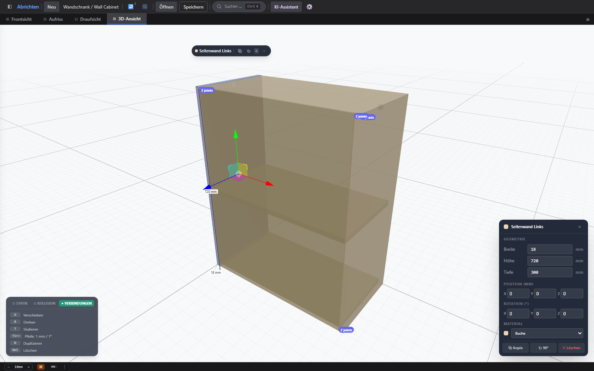

# Abrichten

Desktop application for planning furniture, shelving, and kitchen projects in wood and stone. Combines a full-screen 3D canvas with glass-card overlays, context-aware shortcuts, and AI-assisted sketch analysis.



*(regenerate with `npm run build && npm run screenshot [project.abrichten.json] [quad|3d] [board name]`; without a file the bundled sample project is used)*

## Features

### Canvas & Modelling
- **Single unified canvas** — one React Three Fiber scene in a dark viewport, four camera modes (front, side, top, 3D); boards are drawn opaque in their material colour with edge lines; every project load frames the model
- **Quad layout** — all four views side by side, toggled with "4 Ansichten" in the view tabs; every quadrant is fully interactive in its own view (drag, marquee, measuring, handles)
- **Boards** — parametric rectangles with width × height × depth, material, grain direction, edge banding, rectangular cutouts measured from the board's min-x / min-z corner. World axes: x left → right, y up, z from the wall side (z = 0, backs) towards the front (+z, where the front view and the 3D camera look from) (hob / sink openings render as holes, cutouts reaching the edge as notches, e.g. a shelf notched around posts; exported as a DXF layer; mesh in `utils/boardGeometry.ts`). The smallest dimension is the thickness; cost, edge banding (E1/E2 along the first face axis, E3/E4 along the second), nesting, DXF and boring all work on the face of the other two (rule in `utils/boardFace.ts`)
- **TransformControls gizmo** — translate / rotate in 3D view; pointer-drag in orthographic views; `Esc` during a drag cancels it, other shortcuts wait until the drag ends
- **Resize handles** — in scale mode one cube per face moves that face along the board's own (rotated) axis while the opposite face stays put
- **Zoom & pan** — scroll-wheel zoom around cursor, right-click drag to pan; state persisted per view
- **Snapping** — to the grid (configurable step) and, while dragging, to the faces of other boards (touching or flush, about 8 px reach; `utils/snap.ts`); hold `Alt` to drag freely
- **Tool strip** — Select / Measure / Angle / Area at the left edge of the canvas (keys `1`–`4`)
- **Assembly X-ray** — highlight one assembly and its edges show through everything else while the rest is ghosted; drag boards between assemblies in the tree

### Overlays (in-canvas glass cards)
- **FloatingPropertiesCard** — appears bottom-right when a board is selected; edit name, W×H×D, material, grain direction, edge banding E1–E4, cutouts, duplicate, rotate 90°, delete; collapsible sections (remembered); lists the board's joints — click one to edit its type, fasteners and note; with the static overlay on, a lying board gets a payload field
- **ContextHUD** — bottom-left card with overlay switches (Static / Collision / Joints — joints are off by default) and context-sensitive shortcut hints; folds away (remembered) and folds itself in the quad layout and narrow windows
- **AssemblyDrawer** — docked column on the left (the canvas moves aside) showing the assembly tree; toggle with the toolbar button or `B`. Hiding an assembly (eye icon) also leaves it out of the cutting list, fastener summary, cost, nesting, boring list and shop drawings, so one project can hold design variants as separate assemblies and only the visible one is counted (rule in `utils/activeParts.ts`). Assemblies nest: drag a group onto the middle of another to put it inside, onto its top or bottom edge to reorder; the context menu adds a subgroup or moves one back to the top level. Eye and X-ray apply to the whole subtree, deleting a group deletes its subgroups, and files without nesting load unchanged (tree rules in `utils/assemblyTree.ts`). Groups start collapsed; selecting a board opens its group and every group above it, then scrolls to it
- **ChatPanel** — AI assistant as a fixed right-edge drawer

### Analysis & Engineering
- **Load simulation (statics)** — self-weight (volume × density, or a part's own weight such as an appliance's datasheet weight, `Board.weightKg`, set in the properties card in statics mode), payload, loads placed on a board and everything resting on it are followed down to the floor: shelves hand their load to the side panels, worktops to the cabinets below (`services/static-sim.ts`). Every board is solved as a 2D finite-element model in its own plane (`services/static-fe.ts`): a lying board as a Kirchhoff plate (12-DOF ACM rectangles, `utils/fe/plate.ts`; orthotropic for solid wood with a grain direction: E/30 and f/60 across the grain, G = E/16), a standing board — side panel, back, post, rail on edge — in plane stress (rectangles with incompatible modes, `utils/fe/planeStress.ts`), on a grid with lines at its edges, cutouts, supports and loads (`utils/fe/grid.ts`, at most a few hundred elements), solved with a banded Cholesky (`utils/fe/band.ts`). Supports are the contact area with the board below, the touching end of a shelf over the contact length, or two shelf pins per end, 37 mm in from the front and back edges, when shelf pins are attached; supports only push, a board that would lift off leaves them (`utils/fe/contact.ts`). The project's joints are the load path between the boards they connect (`applyJoints` in `services/static-sim.ts`): a joint holds the two boards over their contact region — also across a gap of up to 15 mm, as drawer runners and spacer strips leave it — and replaces their resting contact; what stands on something (floor, resting and end contacts) stands, and its joints only brace it, while a board that does not stand hangs on its joints, on the boards nearer to the standing ones (also below them) — so a cladding nailed to a frame of battens carries nothing for the frame and hangs on it, and a shelf screwed between two side panels rests on them as on its ends. Joints push first, like a contact over their region; only where a board would otherwise tip or come off does the row of fasteners (the region's middle line) also pull, while the rest of the region keeps pushing (and clamp where it would swing), and that pull stays in the joint. A contact state that does not settle (a pushing support left pulling) is not taken as a solution. Every joint braces a standing panel: its buckling length is the longest stretch between its joints, not its height. A board that would tip on what it touches (a drawer bottom grazing a rail with its front edge) takes its place in the load path from its joints, so a drawer hangs on its runners. Loads enter where they bear: a shelf's reactions at its pins or along its dado, a cabinet side along its bottom edge on a worktop, a cladding's weight at its nail strips. Every load is taken as permanent (EN 1995-1-1, service class 1): strengths are reduced by k_mod and the deflection is the final one, creep included (× (1 + k_def)) — solid timber 0.6 / 0.6, plywood 0.6 / 0.8, OSB 0.4 / 1.5, particleboard and HDF 0.3 / 2.25, MDF 0.2 / 2.25, float glass k_mod 0.25 (DIN 18008-1), stone and metal unchanged (`permanentMaterial` in `data/materials.ts`). Utilisation is the principal stress against that long-term strength (solid wood: the quadratic Norris criterion), for standing panels at least their Euler buckling share; deflection counts against the free span it occurs in (span/300 warns, span/200 is critical). A standing panel whose centre is not over what it stands on (a side panel on a rail at its front edge) is carried by its joints to steadily standing boards (posts, rails). The result is painted on the boards as an FE-style field from green to red, switchable between stress and deflection; the colour range is the whole model (0 … its highest value, with real numbers on the legend, the default), each board on its own, or absolute (100 % = breaks) — the markers always give absolute percentages, with contour lines at 25/50/75/100 %, a ring and label exactly at the maximum of every board that needs attention (“max. 78 %”, “Bruch · 132 %”), the supports of the selected board (cones where it rests, squares where it is joined), purple for boards without adequate support, and an optional deformed shape exaggerated ×20 (`components/overlays/StaticOverlay3D.tsx`, `staticFieldGeometry.ts`). The legend folds to its title row (remembered) or switches the overlay off (×); it sets the payload per shelf and places loads by clicking a board (“Last setzen”, `Board.loads`); the properties card lists them with their weight. Each board's solution is cached on its inputs, so a change re-solves only the boards it reaches (a 100-board kitchen with 263 joints: about 0.3 s from scratch, 5–15 ms per change). Characteristic strengths and stiffnesses per EN 338 / EN 312 / EN 622-5 / EN 300 / EN 438 and safety factors in `data/materials.ts`; rating rules and the colour scale in `services/static-calc.ts`. The summary panel lists load, span, maximum utilisation and where it occurs on the face, sag against the allowance and the minimum thickness; the AI context gets the problem boards. Checked against closed-form plate, beam and plane-stress results (`tests/unit/sim-plate.test.mjs`, `sim-plane.test.mjs`). Assumptions: thin plates (no shear deformation; spans shorter than four thicknesses are not checked for deflection, and a lying board narrower than four thicknesses — a 40 × 60 timber — is a beam: only its bending along the length counts), linear elastic, every board solved on rigid supports (loads are not shared by stiffness between supporters); joint and fastener strength, wall mounting, drawer runners and out-of-plane loads on standing boards are not modelled
- **Collision detection** — AABB overlap, highlighted in-canvas with collision box overlay; an overlap that lies inside a notch or hole of an unrotated board is not a collision, nor is a panel sitting in the groove of a dado/rabbet joint
- **Joints & fasteners** — butt, miter, dado, rabbet, dowel, biscuit, screw, pocket screw, dovetail, lap and glued joints between any two boards, also across assemblies; each joint carries its fasteners (screws, dowels, angle brackets, joist hangers, staples) and a workshop note; markers in 3D at the centre of the contact region, joint count badge on selected boards, dado/rabbet grooves drawn into the host board where the other board sits
- **Dimension overlay** — staggered dimension lines for up to three selected boards (one overall dimension for larger selections) and assembly total dims

### Panels (via ⌘K command palette)
- **Carcass generator** — build a full cabinet from outer dimensions in one undo step, back towards the wall (z = 0); the back sits in grooves (with dado joints) or is applied to the back face, without collisions
- **Cutting list** — sortable table of the parts in visible assemblies as length × width × thickness with grain "längs"/"quer" (`utils/cuttingDims.ts`), grouping of identical parts, fastener summary (screws, brackets, staples by size), a cut plan for bar stock — solid wood up to 10 cm wide (battens, rails, square timber) packed longest first onto stock bars with saw kerf and end trim, per material and section (`utils/barCutting.ts`, `components/panels/BarCutPlan.tsx`) — CSV and DXF export, print; lengths are shown in the project's display unit (status bar: mm, cm, m); the group column shows the full path (e.g. Küche › Backofen) and the list says how many hidden assemblies are left out
- **Sheet nesting** — guillotine-optimised layout, recomputed live while you change the sheet, with SVG / DXF export; parts with a grain direction keep it along the sheet length (materials without grain may turn), kerf only between parts, efficiency counts placed parts only
- **Shop drawings** — DXF/PDF workshop drawings per assembly, with a preview in the dialog
- **Cost calculator** — material + hardware cost breakdown with PDF export; materials without an own price use guide prices (`data/defaultPrices.ts`), marked "Richtwert"
- **Hardware catalogue** — Blum, Grass, Hettich fittings with quantity take-off
- **32 mm boring list** — system drilling pattern for the side panels (not backs) plus the bores of attached hardware, export for CNC
- **Drawer calculator** — Blum TANDEM, Grass Nova Pro, Hettich ArciTech sizing; "Schubkasten erzeugen" builds the drawer box as a new assembly
- **Hinge calculator** — CLIP top / Sensys / Tiomos boring diagram + recommendation, prefilled from the selected door; "Auf gewählte Tür anwenden" attaches the hinges, so the boring list shows the cups
- **Parameters panel** — named dimension references usable in formulas (`=H-18`, comma decimals accepted); changing a parameter resizes every board that uses it in one undo step, deleting one keeps the sizes and unlinks the formulas
- **Tolerance reference** — 10 standard clearances with nudge controls
- **Custom materials** — CRUD for project-specific materials with per-material pricing; used by cost, statics and nesting like the built-in ones
- **Measurement tools** — point-to-point distance, angle, area with snap

### Workflow
- **Undo / Redo** — full history via zundo (Zustand temporal middleware); opening a file or starting a new project starts a fresh history
- **Unsaved changes** — a bullet in the window title and a marker in the status bar while the project differs from the last saved file; New / Open ask first, closing the window asks to discard (`hooks/useUnsavedChanges.ts`). Discarding also resets the auto-save; after a crash the auto-save comes back marked as unsaved
- **Save / Load** — JSON project file via Electron file dialog (Ctrl+S / Ctrl+O); exports (CSV, DXF) get a save dialog filtered by their file type; the CSV delimiter is set in Settings
- **Auto-save** — IndexedDB via Dexie on every project change; an auto-save that no longer loads is reported on start and kept as `unreadable-<time>` in the `abrichten-db` database instead of being overwritten
- **Print** — cutting list, cost and shop drawings print through a hidden sandboxed iframe (`utils/printHtml.ts`); all user text is escaped
- **Onboarding** — first-launch welcome dialog with sample project
- **AI assistant** — upload a sketch or describe a piece; Claude / GPT via OpenRouter creates boards in one undo step. Values like `"600mm"` are accepted; boards with unusable values are skipped and the reason is shown
- **I18N** — German and English, switchable at runtime; the choice is remembered
- **Safe loading** — project files and AI boards are validated and normalised (sizes up to 100 m, names single-line, colours hex only, parameter names identifiers; limits in `utils/validateProject.ts`); a malformed file is rejected with a message instead of breaking the scene
- **Error boundary** — a crashing panel shows the error with retry and reload buttons instead of a blank window
- **Sandboxed renderer** — sandbox and context isolation on, a Content Security Policy (`src/renderer/index.html`), links open in the system browser only for `https:`, and the window never navigates away from the app; the preload exposes only the file dialogs
- **Dialogs** — one dark dialog style with a single primary action (`components/ui/Dialog.tsx`); all panels open from the "Panels" toolbar button or `Ctrl+K`
- **Accessibility** — dialogs are announced as modal, trap focus and close with `Esc`; while a dialog is open the canvas shortcuts are off (except `Ctrl+S`); the board context menu works from the keyboard and offers duplicate, rotate 90°, create joint, move to an assembly, hide the assembly and delete

## Tech Stack

| Area | Technology |
|---|---|
| Desktop | Electron 45 |
| Build | electron-vite 5 + Vite 7 |
| Frontend | React 19 + TypeScript |
| Styling | TailwindCSS v4 |
| State | Zustand 5 + zundo (undo/redo) |
| 3D | React Three Fiber 9 + @react-three/drei 10 |
| Persistence | Dexie (IndexedDB) |
| I18N | i18next + react-i18next |
| AI | OpenRouter API (VLM / chat) |

## Requirements

- **Node.js** >= 22.12 (Electron 45 and Vite 7; `engines` in `package.json`), >= 22.18 for `npm run test:unit`, which imports TypeScript directly
- **npm** >= 9 — `npm install` also downloads the Electron binary (postinstall); after `--ignore-scripts` run `npx install-electron`

## Installation & Dev

```bash
git clone <repo-url>
cd abrichten
npm install

# optional: AI assistant config for `npm run dev` (builds take the key from Settings)
cp .env.example .env   # then add your OpenRouter API key

# development (hot-reload, Electron window opens automatically)
npm run dev

# production build
npm run build
```

`npm run dev` starts a Vite dev server on `localhost:5173` and opens the Electron window.

## Testing

End-to-end tests (Playwright) drive the built renderer in headless Chromium — no Electron needed:

```bash
npm run build            # tests run against the build output in out/renderer
npm test                 # run all E2E specs
npm run test:e2e:headed  # watch the browser while tests run
npm run test:unit        # node:test unit tests, no extra dependencies
```

The suite in `tests/e2e/` (128 tests in 34 spec files) covers boot, selection, keyboard shortcuts, undo/redo, gizmo drags (translate / resize / rotate) and interrupting them, camera pan & zoom, view switching, the quad layout, marquee-vs-drag selection, cutouts, project-file validation with joint pruning and hostile files, every panel opening without a page error, hidden assemblies dropping out of the cutting list, the assembly tree, the carcass generator, printing, parameters and formulas, dialogs and the context menu from the keyboard, the static heat map, snapping to other boards, joint editing, the calculators acting on the model and the layout (drawer, tool strip, labels never over dialogs). The unit tests in `tests/unit/` (136 tests) check the board rotation and resize math against Three.js, the thickness rule, the beam solver against closed-form results and the load paths of the simulation, nesting, export escaping, collision with grooves, joint and groove positions, file validation, formulas, store actions, snapping, the sample project and cutting dimensions.

Electron-only behaviour (main process, preload, printing in the real window) is not covered by Playwright: smoke-test the built app with `electron.exe .` and a separate `--user-data-dir`, so your own auto-save is not touched.

## Project Structure

```
src/
├── main/               # Electron main process
│   └── index.ts
├── preload/            # Electron preload (exposes electronAPI)
│   └── index.ts
└── renderer/
    └── src/
        ├── components/
        │   ├── UnifiedCanvas.tsx     # Single R3F canvas hosting all views
        │   ├── CameraController.tsx  # Ortho + perspective cameras, zoom/pan
        │   ├── OrthoGrid.tsx         # Grid that follows the active view
        │   ├── ErrorBoundary.tsx     # Root error boundary (message instead of a blank window)
        │   ├── layout/     # Toolbar, StatusBar, AssemblyDrawer, CommandPalette, ViewTabs, QuadLayout, PanelHub, SettingsDialog
        │   ├── overlays/   # FloatingPropertiesCard, ContextHUD, gizmo handles, dimension/static/collision overlays
        │   ├── panels/     # CuttingList, NestingPanel, CostPanel, HardwarePanel, KorpusPanel, …
        │   ├── views3d/    # Board3D mesh with drag & transform logic
        │   ├── tools/      # MarqueeSelect, MeasureTools3D
        │   ├── ai/         # ChatPanel
        │   ├── onboarding/ # WelcomeDialog with sample project
        │   └── ui/         # ContextMenu
        ├── config/         # Env-based configuration (.env)
        ├── data/           # Materials, hardware catalogue, board presets
        ├── hooks/          # useKeyboard, useAutoSave, measurement hooks
        ├── i18n/           # de.json, en.json
        ├── services/       # Static calc, boring calc, OpenRouter client, IndexedDB storage, project file open
        ├── store/          # useProjectStore, useUIStore (Zustand)
        ├── types/          # TypeScript interfaces (Board, Assembly, Joint, …)
        └── utils/          # Units, board face/thickness, collision, snap, DXF, nesting, projection, printing, project validation, text escaping
tests/
├── e2e/                # Playwright specs, static server, drag/camera helpers
└── unit/               # node:test specs (import .ts directly)
```

## Keyboard Shortcuts

### Always

| Key | Action |
|---|---|
| `F` | Fit view |
| `S` | Toggle snap |
| `B` | Toggle assembly drawer |
| `Alt+G` | Toggle grid |
| `?` | Show all shortcuts |
| `Ctrl+K` | Command palette |
| `Esc` | Close the topmost dialog, else cancel a running drag, else deselect |
| `+` / `−` | Dimension label size |
| `Ctrl+Z` | Undo |
| `Ctrl+Shift+Z` | Redo |
| `Ctrl+O` | Open project |
| `Ctrl+S` | Save project |
| `1` – `4` | Select / Measure / Angle / Area tool |
| `Alt+1` – `Alt+4` | Front / Side / Top / 3D view |

### Board selected

| Key | Action |
|---|---|
| `D` | Duplicate (Ctrl+D also works) |
| `Delete` | Delete selected board(s) |
| `G` | Translate mode (3D) |
| `R` | Rotate mode (3D) |
| `T` | Scale mode (cubes move one face along the board's own axes) |
| `J` | Create joint (requires 2 boards) |
| `↑ ↓ ← →` | Nudge 1 mm |
| `Shift + arrows` | Nudge 10 mm |
| `Alt` while dragging | Drag without snapping to grid or other boards |
| `Ctrl+A` | Select all boards in assembly |
| `Shift+F10` / Menu key | Context menu of the selected board |

## Settings

Via the `⚙` button in the toolbar:

- **Language** — Deutsch / English
- **OpenRouter API key** — required for the AI assistant
- **VLM model** — model selection for image and chat analysis

Alternatively, configure the AI assistant via a `.env` file in the project root (see [.env.example](.env.example)): `VITE_OPENROUTER_API_KEY`, `VITE_OPENROUTER_MODEL`, and optionally `VITE_OPENROUTER_BASE_URL` for any OpenAI-compatible endpoint. Values from the Settings dialog take precedence. The key from `.env` is used by `npm run dev` only and never inlined into a build (`config/env.ts`); a built app takes the key from the Settings dialog.

## License

MIT — see [LICENSE](LICENSE)
